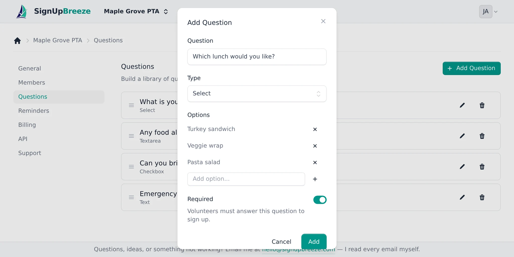
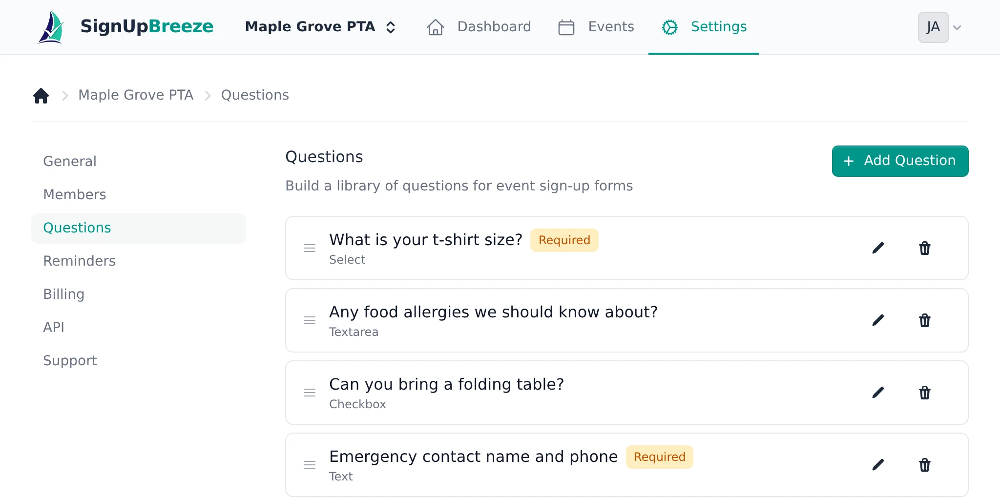
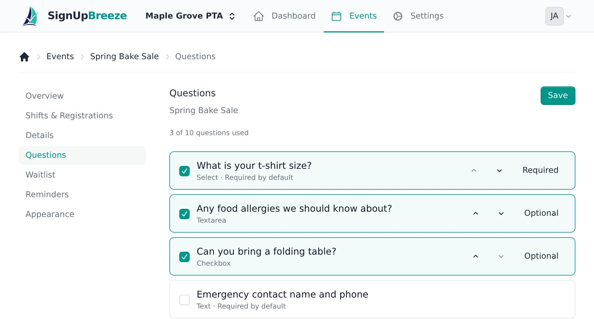
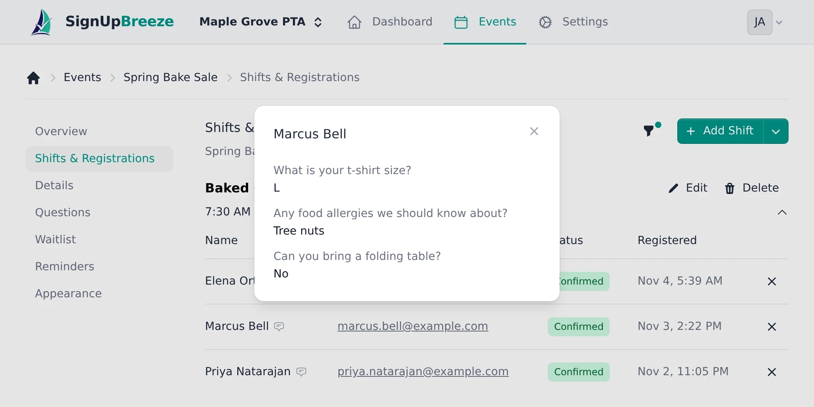

Custom questions let you collect extra information when volunteers sign up — t-shirt sizes, dietary needs, emergency contacts, and more. You build a question once in your organization's library, then reuse it across as many events as you like.

## Availability

Custom questions are available on paid plans. The number you can add per event depends on your plan:

- **Free** — not available.
- **Starter** — up to 3 questions per event.
- **Pro** — up to 10 questions per event.

## Building your question library

Go to **Settings > Questions** to manage your organization's question library. Click **Add Question** and set:

- **Question** — the label volunteers see, such as "What is your t-shirt size?"
- **Type** — Text, Textarea, Select (single choice), Multi select (multiple choices), or Checkbox.
- **Options** — for Select and Multi select, add the choices volunteers can pick from.
- **Required** — whether volunteers must answer this question to sign up.

<Frame caption="Adding a Select question with three options">
  
</Frame>

Drag questions by the handle to reorder them. To change a question later, click the **pencil** icon; to delete it, click the **trash** icon.

<Frame caption="Your organization's question library">
  
</Frame>

<Note>Deleting a question removes it from every event it's attached to. Editing a question updates it everywhere it's used.</Note>

## Adding questions to an event

Open an event and select the **Questions** tab. Your library questions are listed here.

1. **Select questions** — check the questions you want on this event, up to your plan's limit. A counter shows how many you've used (for example, "2 of 3 questions used").
2. **Set the order** — use the up and down arrows to arrange how questions appear on the sign-up form.
3. **Override required/optional** — toggle a question between **Required** and **Optional** for this event, regardless of its library default.
4. **Save** — click **Save** to apply.

<Frame caption="Choosing which library questions appear on an event">
  
</Frame>

<Note>Your library is empty? You'll be prompted to create questions in **Settings > Questions** first.</Note>

## How volunteers answer

Once attached, questions appear on the event's public sign-up form. Volunteers answer them as part of signing up, and again when accepting a spot from a waitlist. You'll see each volunteer's answers next to their registration on the **Shifts & Registrations** tab: click the speech-bubble icon beside a volunteer's name to open them.

<Frame caption="A volunteer's answers to the event's questions">
  
</Frame>
