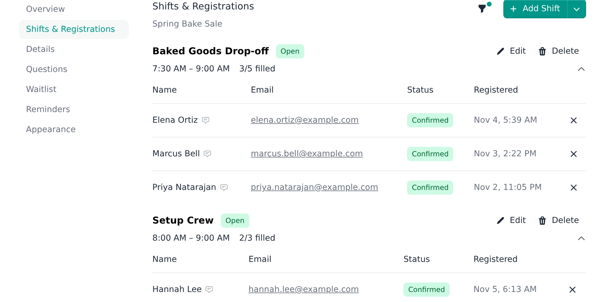
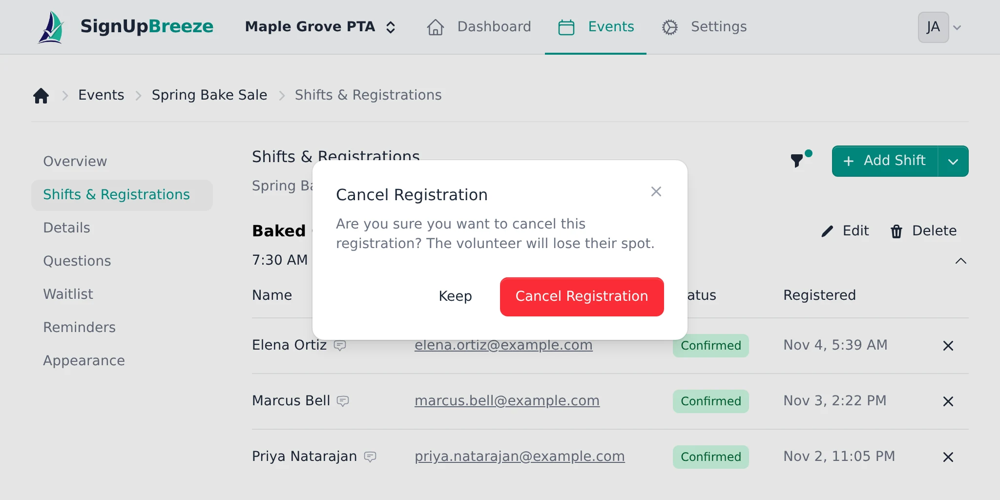
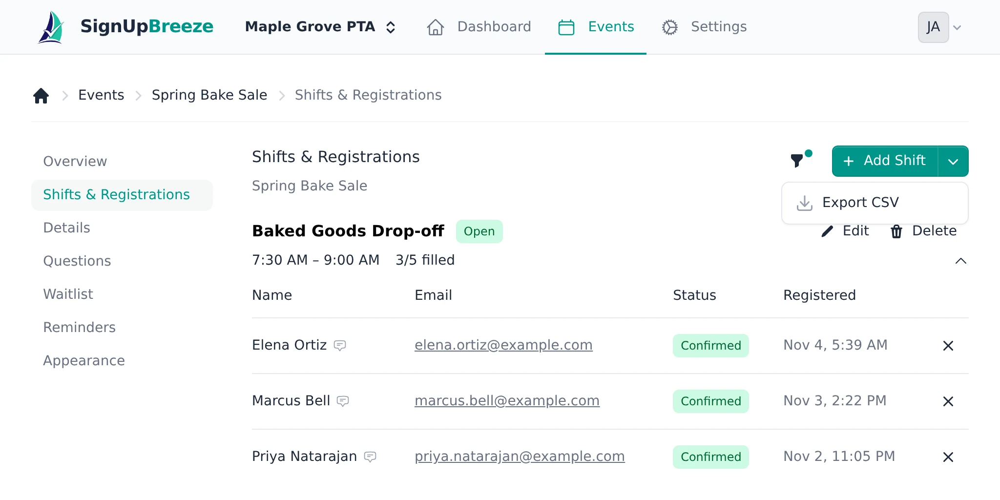
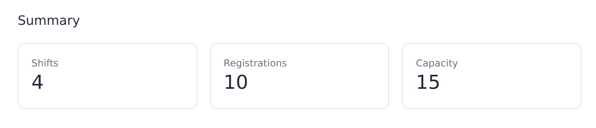

Once volunteers start signing up for your event, you can track and manage their registrations from the **Shifts & Registrations** tab.

## Viewing registrations

Navigate to your event and select the **Shifts & Registrations** tab. Registrations are grouped by shift. For each registration, you'll see:

- **Name** — the volunteer's name
- **Email** — their email address (clickable)
- **Status** — "Confirmed" or other status badges
- **Registered** — the date and time they signed up

<Frame caption="Registrations are grouped by shift, with a fill count for each">
  
</Frame>

## Removing a registration

Click the **X** button to the right of any registration, then click **Cancel Registration** to confirm. The volunteer loses their spot, which frees it up for someone else.

<Frame caption="Confirm before a registration is cancelled">
  
</Frame>

## Exporting registrations (CSV)

On paid plans, you can download your event's registrations as a spreadsheet. From the **Shifts & Registrations** tab, open the actions menu and choose **Export CSV**. The file includes each volunteer's status, name, email, shift, sign-up time, and their answers to any custom questions on the event.

<Frame caption="Export CSV is in the menu next to Add Shift">
  
</Frame>

<Note>CSV export is a paid feature. On the free plan, the option isn't available.</Note>

## Monitoring capacity

Each shift shows its time and a fill count (e.g. "2/3 filled") next to its name. This gives you a quick sense of which shifts still need people and which are close to full.

## Event overview summary

For a high-level view, go to the **Overview** tab. The Summary section shows three cards:

- **Shifts** — total number of shifts in the event
- **Registrations** — total number of signups across all shifts
- **Capacity** — total spots available across all shifts

<Frame caption="The Summary section on the Overview tab">
  
</Frame>

This gives you a snapshot without needing to dig into individual shifts.
